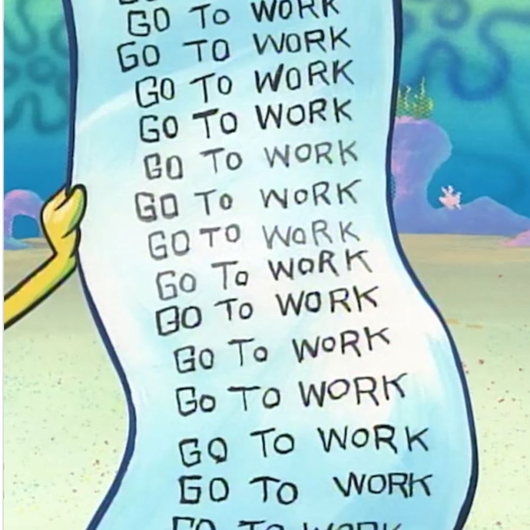
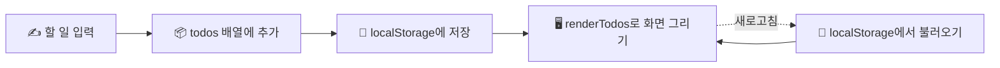

<div align="center">

# 📝 MY TODO LIST

**٩(๑>∀<๑)۶ 오늘의 할일은 내일의 나의 것이 아니다 ٩(๑>∀<๑)۶**



<br><br>


HTML, CSS, 바닐라 자바스크립트로 만든 **할 일 관리 웹앱**이에요.<br>
AX 프론트엔드 과정에서 자바스크립트를 연습하며 만들었어요 🌱

</div>

<br>

## ✨ 주요 기능

https://github.com/user-attachments/assets/3c3e3f13-ff05-4bfa-b590-575494a7a7e2


| | 기능 | 설명 |
| :---: | --- | --- |
| ➕ | **할 일 추가** | 내용, 마감기한, 우선순위를 한 번에 등록해요 |
| ✅ | **완료 체크** | 체크하면 ~~이렇게~~ 취소선이 그어져요 |
| ✏️ | **수정** | 내용, 마감기한, 우선순위를 다시 입력할 수 있어요 |
| 🗑️ | **삭제** | 다 끝난 할 일을 목록에서 지워요 |
| 💾 | **자동 저장** | 새로고침해도 목록이 그대로 남아 있어요 |
| 💬 | **빈 목록 안내** | 할 일이 없으면 안내 문구를 보여줘요 |

#### 🚦 우선순위

`낮음` → `보통` → `중요` → `매우중요`

<br>

## 🚀 실행 방법

설치할 것 없이 바로 열면 돼요!

```bash
git clone https://github.com/yeji-jang/AX_frontend_Javascript_practice.git
```

그다음 `index.html`을 브라우저로 열어 주세요 🖱️

<br>

## 📁 폴더 구조

```
📦 AX_frontend_Javascript_practice
 ┣ 📂 css
 ┃ ┗ 📜 style.css      기본 스타일 (여백 초기화, 글꼴)
 ┣ 📂 js
 ┃ ┗ 📜 todo.js        ⭐ 투두리스트 기능 (추가 · 완료 · 수정 · 삭제 · 저장)
 ┣ 📄 index.html       화면 구조 (입력 폼, 할 일 목록)
 ┗ 🖼️ todolist.jpg     화면에 넣은 이미지
```

<br>

## ⚙️ 이렇게 동작해요



<details>
<summary><b>📦 할 일 하나는 이렇게 저장돼요 (클릭해서 펼치기)</b></summary>

<br>

```js
{
  id: 1763190000000,             // 만든 시각(Date.now())을 고유 번호로 사용
  content: "자바스크립트 복습",    // 할 일 내용
  deadline: "2026-11-15T18:30",  // 마감기한 (없으면 "")
  ranktype: "중요",              // 우선순위 (없으면 "")
  completed: false               // 완료 여부
}
```

</details>

<br>

## 📚 배운 점

- 🔹 `DOMContentLoaded`로 HTML을 다 읽은 뒤 코드 실행하기
- 🔹 `addEventListener`로 `submit` · `click` · `change` 이벤트 다루기
- 🔹 `event.preventDefault()`로 폼 제출 시 새로고침 막기
- 🔹 `createElement` · `append`로 화면 요소 직접 만들기
- 🔹 `localStorage` + `JSON.stringify` / `JSON.parse`로 데이터 저장하기
- 🔹 `filter`로 배열에서 원하는 항목 지우기

<br>

## 🎯 앞으로 해보고 싶은 것

- [ ] 🎨 Tailwind CSS로 화면 꾸미기
- [ ] ✏️ `prompt` 대신 화면 안에서 바로 수정하기
- [ ] 🔃 우선순위 · 마감기한 순으로 정렬하기
- [ ] 🔍 완료한 일 / 남은 일만 골라 보기

<br>

<div align="center">

**Made with 💛 by [yeji-jang](https://github.com/yeji-jang)**

</div>
